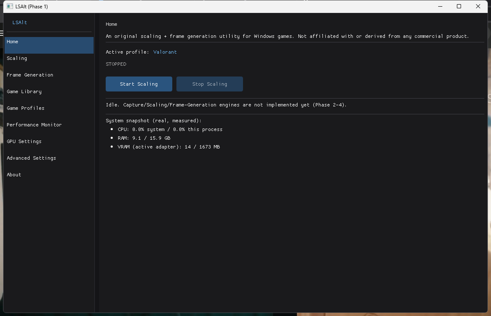
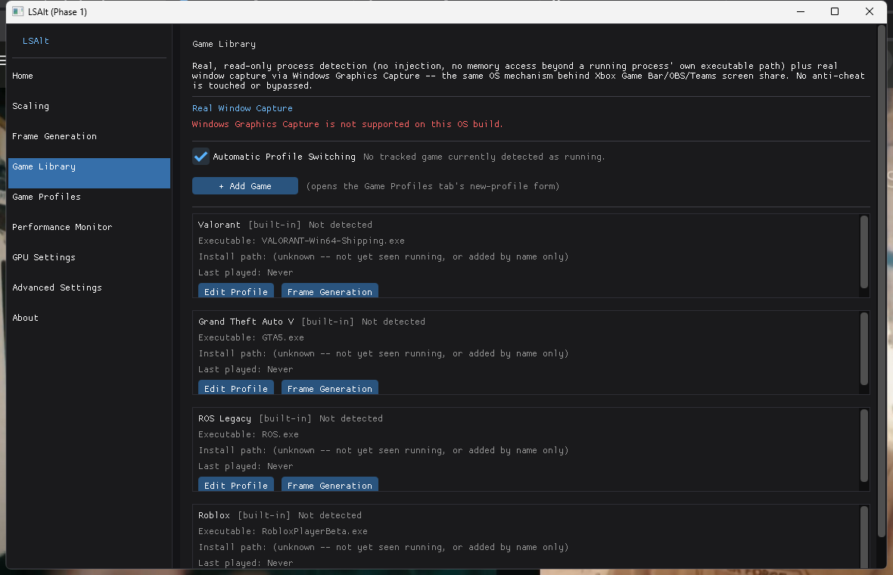
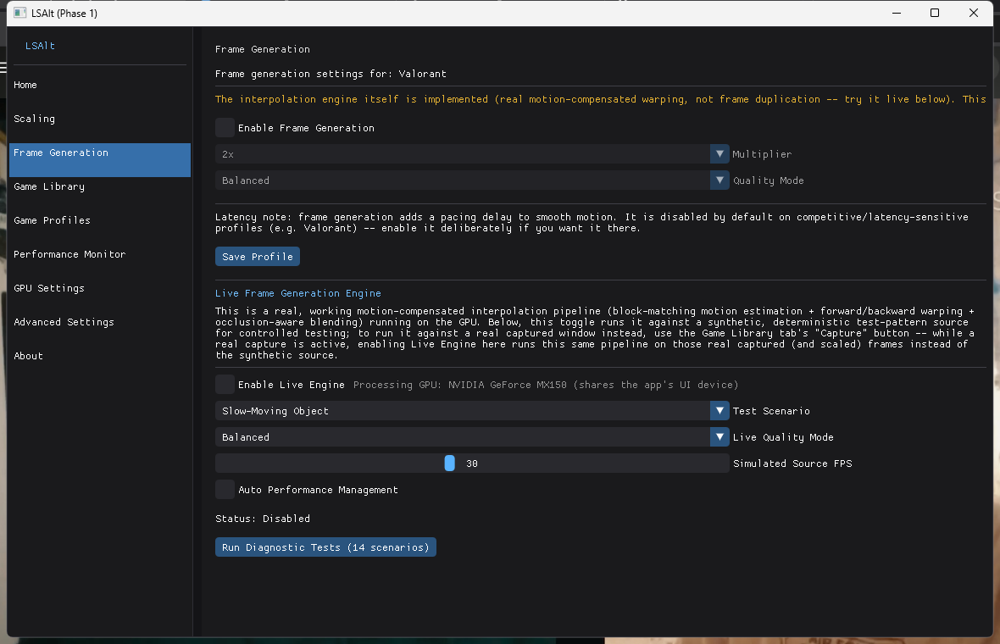
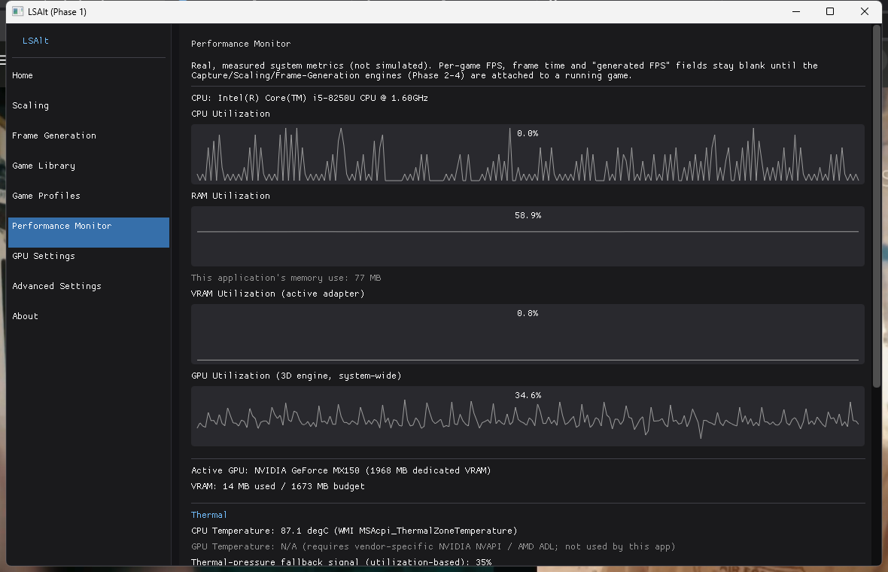

# LSAlt (working title)

An original, independently implemented Windows desktop application that
captures, upscales, and frame-generates game output to improve perceived
smoothness — inspired by the *category* of tool that Lossless Scaling
popularized, built from scratch with its own architecture, code and UI.
**Not affiliated with, derived from, or endorsed by that or any other
commercial product**; no proprietary source, binaries, icons or branding
are used here.

Targets entry-level/low-VRAM gaming laptops first (dev/reference hardware:
Intel Core i5-8250U, NVIDIA GeForce MX150 2GB, Intel UHD Graphics 620,
16GB RAM, Windows 11).

## What actually works right now

Every item below is a real, tested implementation — see
[`docs/HARDWARE_COMPATIBILITY.md`](docs/HARDWARE_COMPATIBILITY.md) for exactly
what was verified on real hardware versus what's a known limitation.

- **Real window capture** via Windows Graphics Capture (the same OS
  mechanism behind Xbox Game Bar / OBS / Teams screen share) — no code
  injection, no anti-cheat interaction.
- **Real image scaling**: Nearest Neighbor, Bilinear, Bicubic, Lanczos,
  Integer Scale, with real aspect-ratio-preserving letterboxing. All GPU
  compute shaders, verified with exact pixel-level ground truth.
- **Real frame generation**: block-matching motion estimation,
  forward/backward warping, occlusion-aware blending — not frame
  duplication. 2x only; 3x/4x are architecture placeholders, not
  advertised as working.
- **Real GPU optimization**: capability-scored adapter auto-selection,
  VRAM-aware quality auto-downgrade, a parallelized motion-estimation
  shader, thermal-aware dynamic performance management, device-loss
  recovery.
- **Real game detection and profile management**: process-based detection
  (no injection), automatic profile switching, a game library UI, JSON
  persistence with corruption recovery and backups. Verified against a
  real, installed, running commercial game (Roblox), not just a
  self-test.
- **Real dedicated output window**: a second top-level window, its own
  D3D11 swapchain, presenting the pipeline's processed output (resizable,
  fullscreen-togglable, aspect-ratio-preserving), automatically excluded
  from capture targets so it can't feed its own output back into itself.
- **Real performance monitoring**: independently measured source/generated/
  displayed FPS (displayed FPS is tied to actual present events, not a
  derived multiple of the others), frame-time graphing, session history
  with CSV export, real CPU/RAM/VRAM/GPU-utilization/CPU-temperature
  telemetry — fields that can't be measured honestly say so (`N/A`)
  instead of showing an invented number.

See [`docs/ARCHITECTURE.md`](docs/ARCHITECTURE.md) for the module map and
real data-flow diagrams, and [`docs/BUILD.md`](docs/BUILD.md) /
[`docs/INSTALLATION.md`](docs/INSTALLATION.md) to build, install, or run it.

## Screenshots

(Actual running application, not mockups — Intel UHD 620 + NVIDIA MX150
dev hardware.)

| Home | Game Library |
|---|---|
|  |  |

| Frame Generation | Performance Monitor |
|---|---|
|  |  |

## Known limitations

- 3x/4x frame generation are not implemented.
- FSR1/NVIDIA Image Scaling are not implemented (fall back to Bilinear).
- Real-game, real-*capture* end-to-end testing (actually grabbing a real
  game's frames) was blocked by the dev machine's OS configuration
  (several Windows services disabled by a prior debloat) — see
  [`docs/HARDWARE_COMPATIBILITY.md`](docs/HARDWARE_COMPATIBILITY.md) for
  the exact details. Real-game *detection* (no capture needed) was
  verified against an actually-installed, actually-running copy of
  Roblox. Grand Theft Auto V is not actually installed on the dev machine
  (only the Rockstar Games Social Club launcher is present) and was not
  tested. The capture implementation itself builds, links, and
  correctly detects support/non-support; it has not been verified
  end-to-end against an actual running game on real hardware.

## License / originality note

All code in this repository is original. No code, assets, or branding from
Lossless Scaling or any other commercial application is included. See
[`LICENSE`](LICENSE).
